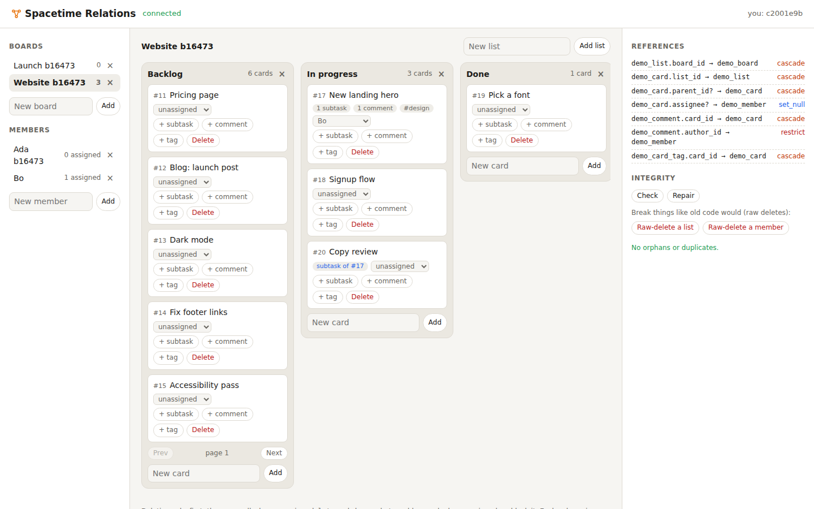
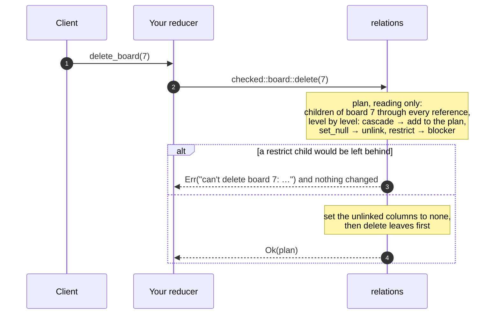

<div align="center">

# 🔧 Spacetime Relations

**Foreign keys, cascading deletes, multi-column unique and pagination for SpacetimeDB.**

Declare how your tables reference each other once. Checked writes refuse rows that point nowhere, and deletes
**cascade**, **set null** or are **refused** (`restrict`), all or nothing. Before deleting, ask what would happen:
"this also deletes 3 lists, 12 cards and 30 comments, and unassigns 2 cards". **Check and repair** find and fix
orphans that older code left behind. **Pagination** comes as keyset cursors and as live, per-client pages you
subscribe to. Available for **Rust**, **C#** and **TypeScript (as a submodule)**, all with the same client-facing
schema.

[](https://github.com/Gazz-Stripbolt/spacetimedb-relations/actions/workflows/ci.yml)


[](https://www.npmjs.com/package/@pogly/spacetimedb-relations)


[](LICENSE)

<picture>
  <source media="(prefers-color-scheme: dark)" srcset="docs/demo-dark.png">
  
</picture>

</div>

---

> [!NOTE]
> SpacetimeDB has no foreign keys yet ([feature request #2608](https://github.com/clockworklabs/SpacetimeDB/issues/2608))
> and only single-column unique constraints. This enforces both **for writes that go through it**. Writes that go
> around it aren't stopped, which is what `relations_check` is for. If native constraints ship, prefer them; the
> declarations here map onto them one to one.

## Where to go

| I want… | Go to |
|---|---|
| **Rust**: add relations to a Rust module | [`rust/`](rust): `relations.rs`, one drop-in file |
| **C#**: add relations to a C# module | [`csharp/`](csharp): `Relations.cs`, one drop-in file |
| **TypeScript**: add relations to a TS module, as a **submodule** | [`typescript/`](typescript): `npm install @pogly/spacetimedb-relations` |
| **See it working**: a kanban board with delete previews and live pages | [`demo/`](demo): one demo per language, sharing one web page |
| **The tables, procedures, types and error texts**, to build a client | [`docs/PROTOCOL.md`](docs/PROTOCOL.md) |
| **Numbers and gotchas** | [`docs/FINDINGS.md`](docs/FINDINGS.md) |

CI runs the same suites against every language:

| | Rust | C# | TypeScript submodule |
|---|---|---|---|
| Protocol tests (references, unique, delete plans, cascade, set null, restrict, cycles, check, repair, cursors, live pages) | ✅ 12/12 | ✅ 12/12 | ✅ 12/12 |
| Browser tests (two people on the demo board) | ✅ 5/5 | ✅ 5/5 | ✅ 5/5 |

## How it works

SpacetimeDB has no triggers, so a module can't watch its own writes. Instead you write through **checked
wrappers**. Deletes plan first, with reads only, then write:



- **One declaration per reference:** `card.list_id -> list [cascade] via by_list`. `restrict`, `cascade` and
  `set_null` (for `Option` columns), self-references and cycles all work.
- **Previews are the real plan.** `preview_delete` returns exactly what `delete` will do: the rows it deletes, the
  references it sets to none, and the rows that block it.
- **Restrict means no orphans are left.** A `restrict` child that the same delete cascades away doesn't block it.
- **Multi-column unique** goes through a btree index on those columns: `card_tag(card_id, tag) via by_card_tag`.
- **Check and repair** (admins only) scan existing data for orphans and duplicates, and apply each reference's rule
  to orphans in one transaction. Useful after a migration, or when adopting relations in a database that already
  has data.
- **Pagination:** `page()` takes one page from a range scan and returns the cursor for the next. For live pages, a
  client stores its cursor with `relations_set_page` and your view reads it with `page_state`. Views can't take
  parameters, so the cursor lives in a row, and the page stays subscribed while others edit.
- **Keys are hex of their BSATN**, so plans and violations can name rows of any table in one type, identically in
  all three languages.

## Quick start (Rust)

```rust
// src/lib.rs (Cargo.toml: spacetimedb = { version = "2.12.*", features = ["unstable"] })
pub mod relations;   // copy rust/relations.rs to src/relations.rs

relations! {
    tables {
        board: Board => id: u64,
        list: List => id: u64,
        card: Card => id: u64,
        member: Member => id: u64,
    }
    references {
        list.board_id -> board [cascade] via board_id,
        card.list_id -> list [cascade] via list_id,
        card.assignee -> member [set_null, nullable],
    }
}

#[spacetimedb::reducer(init)]
pub fn init(ctx: &ReducerContext) {
    relations::configure(ctx);
}

#[spacetimedb::reducer]
pub fn add_card(ctx: &ReducerContext, list_id: u64, title: String) -> Result<(), String> {
    checked::card::insert(ctx, Card { id: 0, list_id, title, assignee: None })?;   // "card.list_id = 9: no such list"
    Ok(())
}

#[spacetimedb::reducer]
pub fn delete_board(ctx: &ReducerContext, id: u64) -> Result<(), String> {
    checked::board::delete(ctx, &id)?;   // its lists and their cards go too
    Ok(())
}
```

Clients get the `relations_fk` / `relations_unique` tables, the `relations_check` / `relations_repair` procedures and
the `relations_set_page` reducer. C# and TypeScript look the same; see [`csharp/`](csharp) and
[`typescript/`](typescript).

## Numbers

From [`tests/bench.mts`](tests/bench.mts): 2,000 rows per call, on the 2-vCPU dev VM. Details are in
[FINDINGS](docs/FINDINGS.md).

| | Rust | C# (NativeAOT) | TypeScript |
|---|---|---|---|
| Raw insert, per row | 16.9 µs | 18.9 µs | 17.7 µs |
| Checked insert, per row | 18.2 µs | 31.2 µs | 24.0 µs |
| Cascade delete of a list with 2,000 cards (plan + apply) | 29 ms | 50 ms | 50 ms |
| First page of 50 from a 2,000-card list | 6.6 ms | 7.9 ms | 9.0 ms |

Each figure is one call's round trip from a client on the same machine (inserts: one call of 2,000 rows, divided by
2,000). The reference check costs one primary-key lookup per reference.

## Good to know

- **Only checked writes are checked.** A raw insert, update or delete skips the rules. Keep raw writes to related
  tables out of your code (`grep` for them), and run `relations_check` after migrations.
- **Nullable references scan.** SpacetimeDB can't index-filter an `Option` column, so finding the children of a
  nullable reference reads the child table, once per level of a cascade. Use a sentinel (`0` = none) on a plain
  column with an index if that table is large.
- **Pages read their whole range** because of an ordering quirk in 2.11 (see
  [FINDINGS](docs/FINDINGS.md#spacetimedb-quirks)). Keep paged ranges narrow, such as one list's cards.
- **Repair doesn't pick winners.** Orphans under `restrict` and duplicate rows are reported, not fixed.

## Repository layout

```
rust/relations.rs       Rust drop-in (+ the relations! macro)
csharp/Relations.cs     C# drop-in (RelationsTable<...> declarations)
typescript/             TypeScript submodule (package: @pogly/spacetimedb-relations)
demo/{rust,csharp,typescript}   the demo module in each language
demo/web/               the shared demo page (one HTML file the modules serve at /route/)
tests/                  protocol tests, browser tests, benchmark
scripts/e2e.sh          publish a demo and run both suites against it
docs/                   PROTOCOL.md · FINDINGS.md · screenshots
```

## Credits

Built by **Tinker** ([@Gazz-Stripbolt](https://github.com/Gazz-Stripbolt)), the resident gadgeteer for the
[Pogly](https://pogly.gg) team: collaborative stream overlays, powered by SpacetimeDB. Pogly's own rows that
outlived their parents (drawings left behind by a bulk delete) are the motivating case for check and repair.

More SpacetimeDB building blocks from this workshop: **[github.com/Gazz-Stripbolt](https://github.com/Gazz-Stripbolt)**.

🚀 **New to SpacetimeDB?** If you sign up through **[this referral link](https://spacetimedb.com/?referral=Lethalchip)**,
Pogly gets free recurring energy. Thank you!

## License

[MIT](LICENSE)
